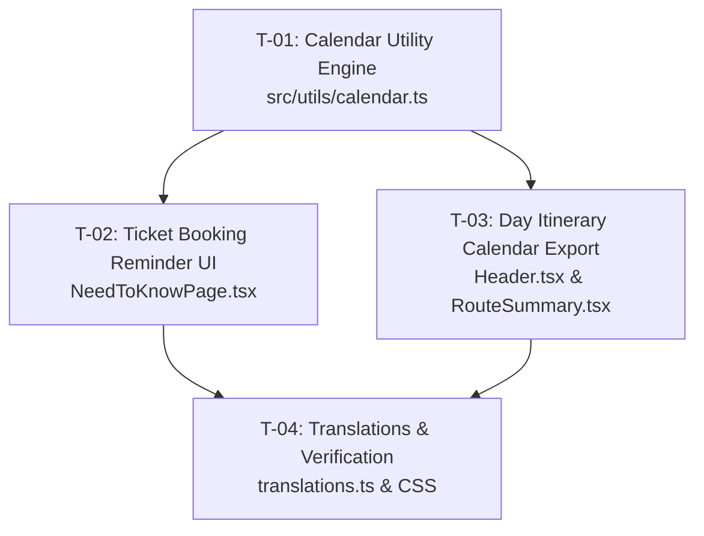

# Implementation Spec: Google Calendar Schedule & Ticket Booking Alarms

**Feature Slug:** `calendar-schedule-and-reminders`  
**Status:** Ready for Review  
**Target Architecture:** React 19 / TypeScript / Static PWA  
**ADR Reference:** `docs/adr/0003-calendar-schedule-and-booking-reminders.md`  

---

## 1. Feature Requirements

### Req 1: Critical Ticket Booking Reminders (Need to Know Page)
For tickets with `category: "must_book_advance"` and `initialStatus: "must_book"` (and when not yet checked off):
1. **Primary Action**: "⏰ เพิ่มแจ้งเตือน Google Calendar"
2. **Options Available**:
   - **วันเปิดจองจริง (Exact Booking Deadline)**:
     - G28 Train: 16 Dec 2026, 12:30–13:00 Bangkok Time.
     - Shanghai Disney Early Entry: 20 Dec 2026, 23:00–23:30 Bangkok Time.
     - Forbidden City: 25 Dec 2026, 19:00–19:30 Bangkok Time.
     - Disney 1.5-Day: 01 Nov 2026, 09:00–09:30 Bangkok Time.
     - Rockbund Christmas: 18 Nov 2026, 09:00–09:30 Bangkok Time.
   - **เตือนล่วงหน้า 1 วัน ตอนเช้า (1 Day Prior Morning 07:30 AM)**:
     - G28 Train: 15 Dec 2026, 07:30–08:00 Bangkok Time.
     - Disney Early Entry: 19 Dec 2026, 07:30–08:00 Bangkok Time.
     - Forbidden City: 24 Dec 2026, 07:30–08:00 Bangkok Time.
     - Disney 1.5-Day: 31 Oct 2026, 07:30–08:00 Bangkok Time.
     - Rockbund Christmas: 17 Nov 2026, 07:30–08:00 Bangkok Time.
   - **ดาวน์โหลดไฟล์ .ics (Apple / Outlook / All)**:
     - Generates `.ics` file with built-in `VALARM` at `-P1D` (1 day before) and `-PT15M` (15 min before).

### Req 2: Day Itinerary Calendar Export
For any active day (Day 1 to Day 9):
1. **Header / Summary Action Button**: "📅 เพิ่มวันใน Calendar"
2. **Behavior**:
   - **Google Calendar (All-Day Summary)**: Creates an all-day event for the specific date with title, duration, stop count, and formatted checklist of all POIs with Chinese names.
   - **Download Full Itinerary (.ics)**: Creates an `.ics` file containing all individual timed stops (e.g. 10:30-11:15 Jing'an Temple, etc.) so travelers have their whole day mapped out on their phone's native calendar!

---

## 2. Technical Contracts

### `src/utils/calendar.ts`
```typescript
export interface CalendarEvent {
  title: string;
  description: string;
  location?: string;
  startDate: string; // ISO string e.g. "2026-12-16T12:30:00"
  endDate: string;   // ISO string e.g. "2026-12-16T13:00:00"
  allDay?: boolean;
  alarmsMinutesBefore?: number[]; // e.g. [1440, 15] (1440 min = 1 day)
}

export function buildGoogleCalendarUrl(event: CalendarEvent): string;
export function generateIcsBlob(events: CalendarEvent | CalendarEvent[]): Blob;
export function downloadIcsFile(filename: string, events: CalendarEvent | CalendarEvent[]): void;
export function getTicketCalendarOptions(ticket: TicketItem): {
  deadlineEvent: CalendarEvent;
  advanceReminderEvent: CalendarEvent;
  icsFilename: string;
};
export function getDayItineraryCalendarOptions(day: DayPlan): {
  summaryEvent: CalendarEvent;
  detailedEvents: CalendarEvent[];
  icsFilename: string;
};
```

---

## 3. Task Graph (Frontier)


